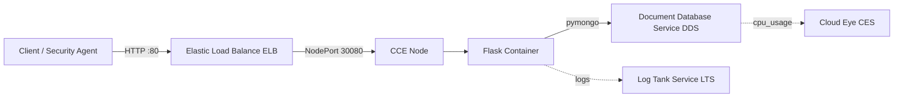

# cloud-native-security-vulnerable-app-agents / 刻意保留漏洞的演示应用，用于安全/运维智能体演练靶场

[](LICENSE)
[](https://www.huaweicloud.com/)
[](#)

> A web application with deliberately planted security flaws, built as a practice target for security agents (code review + penetration testing) and operations agents (incident troubleshooting).

---

## 1. Overview

**What it is**: A small Flask sales portal demo that ships four clearly labelled security flaws plus a demo switch that produces a clean 5xx failure signal. It is a safe, single-use target environment for automated security and operations agents to find, report, and fix issues.

**Who it is for**: Security engineers, platform and operations teams, and anyone building or evaluating automated code-review and incident-response agents. It works as a learning sample or as a regression target for agent pipelines.

### Key Features

- Containerized web application behind a managed load balancer
- Document database persistence (MongoDB compatible)
- Built-in observability: centralized logs and an alarm rule
- Four planted flaws (CWE-798 / CWE-79 / CWE-78 / CWE-306) for agents to discover
- `BREAK_APP` switch: data pages return 5xx while `/health` stays healthy

> ⚠️ This application is **intentionally insecure**. Deploy it only in an isolated sandbox and release it immediately after use.

---

## 2. Architecture

> Layered cloud-native structure: public access → container compute → document storage → observability.



**Key components**:

- **Elastic Load Balance ELB (dedicated)**: public entry on HTTP :80, round-robin to NodePort 30080
- **Cloud Container Engine CCE**: managed Kubernetes cluster running the application container
- **Flask application (gunicorn, :8080)**: the demo sales portal carrying the planted flaws
- **Document Database Service DDS (MongoDB compatible)**: stores `leads` / `notes` documents
- **Log Tank Service LTS**: collects application logs
- **Cloud Eye CES**: raises an alarm when the DDS CPU metric is abnormal

---

## 3. Cloud Services

| Service | Purpose | Notes |
|---|---|---|
| Virtual Private Cloud VPC | Isolated network plane | Subnets, security group, internet gateway, route table |
| Elastic Load Balance ELB (dedicated) | Public HTTP :80 entry | Bound to a public IP |
| Cloud Container Engine CCE | Managed Kubernetes | Cluster plus a node pool (s6.large.2) |
| Document Database Service DDS | MongoDB compatible storage | Replica set, 3 nodes |
| Log Tank Service LTS | Log collection | 7-day retention |
| Cloud Eye CES | Alarm rule | Triggered by an abnormal DDS CPU metric |

> All services above are created by the Terraform code in `infra/`; to release them, see [Section 9](#9-cleanup).

---

## 4. Highlights

- **Four labelled flaws**: credentials embedded in the source, reflected cross-site scripting, OS command injection, and missing authentication with information disclosure.
- **Clean failure signal**: the `BREAK_APP` switch makes data pages return 5xx without affecting the health check.
- **Managed and reproducible infrastructure**: every resource is defined in Terraform, so one command creates or releases the stack.
- **Minimal dependencies**: the application talks to the database directly through `pymongo` and pulls in no cloud vendor SDK.

---

## 5. Prerequisites

| Item | Requirement | Notes |
|---|---|---|
| Account | Huawei Cloud account with identity verification completed | Personal or enterprise |
| Permissions | IAM **Tenant Administrator** or equivalent | Needed to create VPC / CCE / DDS resources |
| Region | For example `cn-north-4` | Confirm flavors and availability zones before apply |
| Terraform | `>= 1.5.0` | Infrastructure as code |
| huaweicloud Provider | `~> 1.70` | Terraform provider |
| kubectl | `>= 1.28` | Cluster management |
| docker | A recent version | Image build and push |
| Access key pair | Access key created | Set it in your local terminal only; never commit real values |

> Set the following shell variables in your local terminal before deploying:
> ```bash
> export HW_ACCESS_KEY="<AK>"
> export HW_SECRET_KEY="<SK>"
> export TF_VAR_dds_password="<strong-password>"
> ```
> Every file in this repository uses placeholders and carries no real credentials.

---

## 6. Quick Start

### One-command deployment (recommended)

```bash
# 1. Clone this repository
git clone <repository-url> <repository-root>
cd <repository-root>

# 2. Set the deployment variables (see Prerequisites)
export HW_ACCESS_KEY="<AK>"
export HW_SECRET_KEY="<SK>"
export TF_VAR_dds_password="<strong-password>"

# 3. Deploy the infrastructure
cd infra
terraform init
terraform plan
terraform apply -auto-approve

# 4. Record the key outputs (app_url, elb_id, dds_connection and so on)
terraform output
```

> **Duration**: about 5-10 minutes. The full walkthrough with expected output is in [Section 7](#7-deployment).

---

## 7. Deployment

### Step 1: Initialize

```bash
cd infra
terraform init
```

**Expected output**: `Terraform has been successfully initialized!`

### Step 2: Preview the changes

```bash
terraform plan
```

**Expected output**: `Plan: N to add, 0 to change, 0 to destroy.`

### Step 3: Apply

```bash
terraform apply -auto-approve
```

**Expected output**: `Apply complete! Resources: N added, 0 changed, 0 destroyed.`

### Step 4: Record the key outputs

```bash
terraform output
```

**Expected output**: lists `app_url`, `elb_id`, `dds_connection` (sensitive), `dds_user`, and `cce_kubeconfig_cmd`.

### Step 5: Deploy the application to CCE

```bash
# Fetch the kubeconfig
$(terraform output -raw cce_kubeconfig_cmd)
kubectl get nodes

# Build and push the image to SWR
cd src
export REGION=cn-north-4 SWR_ORG=<organization> SWR_USER=<user> SWR_PASSWORD=<password>
./build-and-push.sh

# Fill in src/k8s/secret.yaml (MONGO_HOSTS comes from terraform output dds_connection)
# src/k8s/deployment.yaml already ships NodePort 30080, so no ELB annotation needs editing;
# just confirm that terraform output elb_id returns a value
kubectl apply -f src/k8s/secret.yaml
kubectl apply -f src/k8s/deployment.yaml
```

---

## 8. Usage

> **Verify for real**: the commands below confirm that the deployment works end to end. After deploying, walk through them yourself and confirm the business functions work before treating the delivery as complete.

### Check 1: Health check

```bash
curl -i http://<app_url>/health
```

**Expected output**: `HTTP/1.1 200` with the body `{"status":"ok"}`.

### Check 2: Dashboard

```bash
curl -s http://<app_url>/ | head -n 20
```

**Expected output**: HTML containing "Sales Dashboard".

### Check 3: Create and list a lead

```bash
curl -s -X POST http://<app_url>/leads -d "name=Alice&company=Acme"
curl -s http://<app_url>/leads
```

**Expected output**: the new record appears in the lead list.

### Check 4: Demo switch (failure signal)

```bash
kubectl set env deployment/nimbus-app BREAK_APP=true
curl -i http://<app_url>/        # data page returns 500
curl -i http://<app_url>/health  # still 200
kubectl set env deployment/nimbus-app BREAK_APP=false
```

**Expected result**: data pages return 500 while `/health` stays at 200; application logs in LTS show errors and the DDS CPU metric turns abnormal, which feeds the alarm and troubleshooting drill.

---

## 9. Cleanup

```bash
kubectl delete -f src/k8s/deployment.yaml
kubectl delete -f src/k8s/secret.yaml

cd infra
terraform destroy -auto-approve
```

**Expected output**: `Destroy complete! Resources: N destroyed.`

> **Avoid leftovers**: `terraform destroy` releases only the resources tracked in state. Artifacts you created by hand (such as an image pushed to SWR) must be released separately, while resources shared with other workloads in the account are not affected.

---

## 10. Details

### Workflow

A client reaches the public ELB address over HTTP :80; the load balancer round-robins to NodePort 30080 on a CCE node, and the cluster routes the request to the application pod on :8080. The application reads and writes `leads` / `notes` documents in DDS. Application logs flow into LTS, and the DDS CPU metric is reported to CES, which raises an alarm when it turns abnormal.

### Configuration

| Variable | Default | Description |
|---|---|---|
| `region` | `cn-north-4` | Target region |
| `project_name` | `nimbus-demo` | Resource naming prefix |
| `vpc_cidr` | `10.20.0.0/16` | VPC CIDR |
| `subnet_a_cidr` | `10.20.1.0/24` | Subnet A CIDR |
| `subnet_b_cidr` | `10.20.2.0/24` | Subnet B CIDR |
| `dds_password` | (required) | DDS administrator password (sensitive) |
| `break_app` | `false` | When true, data pages return 500 |
| `db_name` | `nimbus` | Demo database name |

### Endpoints

| Path | Method | Description |
|---|---|---|
| `/health` | GET | Health check (returns 200 when the application is healthy) |
| `/` | GET | Dashboard (the `q` parameter is not escaped, leaving it open to XSS) |
| `/leads` | GET/POST | List or create leads |
| `/notes` | GET/POST | List or create notes |
| `/diagnostics?host=` | GET | Runs `ping` against `host` (command injection) |
| `/admin/debug` | GET | Dumps every runtime setting (no authentication) |

---

## 11. Dependencies

| Name | Version | Purpose |
|---|---|---|
| Terraform | `>= 1.5.0` | Infrastructure as code |
| huaweicloud Provider | `~> 1.70` | Huawei Cloud resources |
| Flask | `3.0.3` | Web framework |
| gunicorn | `22.0.0` | WSGI server |
| pymongo | `4.6.3` | MongoDB compatible client |

---

## 12. FAQ

### Q1: apply reports insufficient permissions. What should I do?

**A**: Confirm the account holds IAM **Tenant Administrator** or equivalent service-level administrator permissions (VPC / CCE / DDS).

### Q2: The pod stays Pending.

**A**: Check the node pool status and confirm that the image reference in `src/k8s/deployment.yaml` (SWR organization) is correct and has been pushed.

### Q3: The data page returns 500 after enabling BREAK_APP, but no alarm notification arrives.

**A**: The CES alarm rule in this architecture uses the DDS CPU metric as its signal, because the dedicated ELB entry exposes no 5xx metric. Confirm that the rule exists (`terraform output alarm_name`), that the SMN topic has subscribers, and that the DDS instance is running. The drill can still confirm the 5xx signal from the application logs in LTS.

### Troubleshooting checklist

| Symptom | Likely cause | How to check |
|---|---|---|
| apply fails on a flavor | Flavor unavailable in the region | Compare `variables.tf` / `main.tf` against the target region |
| The application cannot reach DDS | Wrong `MONGO_HOSTS` or password | Compare with `terraform output dds_connection` |
| The public address is unreachable | ELB or IP not bound | Check the `app_url` output and the IP status |

---

## 13. Contributing

Issues and pull requests are welcome. The flow:

1. **Issue**: describe the problem (reproduction steps, expected and actual output, screenshots).
2. **Pull request**: branch off `main`; run `terraform validate` before submitting.
3. **Review**: a maintainer reviews and merges.

See `CONTRIBUTING.md` for the full guidelines, if present.

---

## 14. License

This sample is released under the **MIT No Attribution** license. See the [`LICENSE`](LICENSE) file in the repository root.

```
MIT No Attribution

Copyright (c) Huawei Cloud

Permission is hereby granted, free of charge, to any person obtaining a copy
of this software... (no attribution required)
```

---

## 15. Contact

| Item | Detail |
|---|---|
| **Creator** | [@dgc-git](https://github.com/dgc-git) |
| **Maintainer** | [@dgc-git](https://github.com/dgc-git) |
| **Contact** | Open an issue or pull request (see [Section 13](#13-contributing)) |
