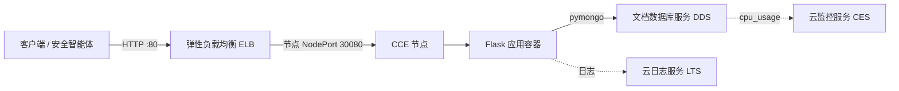

# cloud-native-security-vulnerable-app-agents / 刻意保留漏洞的演示应用，用于安全/运维智能体演练靶场

[](LICENSE)
[](https://www.huaweicloud.com/)
[](#)

> 一个刻意保留安全漏洞的 Web 应用，用于安全智能体（代码审查 + 渗透测试）与运维智能体（故障排查）的演练场景。

---

## 1. 简介

**它是什么**：一个小型 Flask 销售门户演示，内置四类清晰标注的安全缺陷，外加一个「演示开关」用于制造干净的 5xx 故障信号。它是一套安全的、一次性使用的目标环境，供自动化安全与运维智能体发现、上报并修复问题。

**面向谁**：安全工程师、平台 / 运维团队，以及任何构建或评估自动化代码审查与故障响应智能体的团队。可作为学习样例或智能体流水线的回归目标。

### 核心能力

- 容器化 Web 应用，前置托管负载均衡
- 文档数据库持久化（MongoDB 兼容）
- 内置可观测能力：集中日志与告警规则
- 四类植入漏洞（CWE-798 / CWE-79 / CWE-78 / CWE-306）供智能体发现
- `BREAK_APP` 开关：数据页返回 5xx，同时 `/health` 保持正常

> ⚠️ 本应用**刻意不安全**。仅在隔离沙箱中部署，用后即刻释放。

---

## 2. 目录

- [1. 简介](#1-简介)
- [3. 架构图](#3-架构图)
- [4. 方案亮点](#4-方案亮点)
- [5. 涉及云服务](#5-涉及云服务)
- [6. 前置条件](#6-前置条件)
- [7. 快速开始](#7-快速开始)
- [8. 分步部署](#8-分步部署)
- [9. 使用方法](#9-使用方法)
- [10. 清理资源](#10-清理资源)
- [11. 详细说明](#11-详细说明)
- [12. 依赖](#12-依赖)
- [13. FAQ](#13-faq)
- [14. 贡献指南](#14-贡献指南)
- [15. 许可证](#15-许可证)
- [16. 联系方式](#16-联系方式)

---

## 3. 架构图

> 分层云原生结构：公网接入 → 容器计算 → 文档存储 → 可观测。



**关键组件**：

- **弹性负载均衡 ELB（独享型）**：公网入口，HTTP :80，轮询转发到节点 NodePort 30080
- **云容器引擎 CCE**：托管 Kubernetes 集群，运行应用容器
- **Flask 应用（gunicorn，:8080）**：演示销售门户，含植入缺陷
- **文档数据库服务 DDS（MongoDB 兼容）**：存储 `leads` / `notes` 文档
- **云日志服务 LTS**：收集应用日志
- **云监控服务 CES**：DDS CPU 指标异常时告警

---

## 4. 方案亮点

- **四类标注漏洞**：硬编码凭据、反射型 XSS、OS 命令注入、缺失认证 + 信息泄露，便于智能体定位与修复。
- **干净故障信号**：`BREAK_APP` 开关使数据页 5xx，同时不影响健康检查。
- **托管且可复现的基础设施**：所有资源以 Terraform 定义，一条命令即可创建或释放。
- **最小依赖**：应用通过 `pymongo` 直连数据库，不引入云厂商 SDK。

---

## 5. 涉及云服务

| 服务 | 用途 | 备注 |
|---|---|---|
| 虚拟私有云 VPC | 隔离网络平面 | 子网、安全组、互联网网关、路由表 |
| 弹性负载均衡 ELB（独享型） | 公网 HTTP :80 入口 | 绑定公网 IP |
| 云容器引擎 CCE | 托管 Kubernetes | 集群 + 节点池（s6.large.2） |
| 文档数据库服务 DDS | MongoDB 兼容存储 | 副本集，3 节点 |
| 云日志服务 LTS | 日志收集 | 7 天留存 |
| 云监控服务 CES | 告警规则 | DDS CPU 指标异常触发 |

> 以上服务均由 `infra/` 中的 Terraform 创建；如需释放，参见 [第 10 节](#10-清理资源)。

---

## 6. 前置条件

| 项 | 要求 | 说明 |
|---|---|---|
| 账号 | 华为云账号，已完成实名认证 | 个人或企业均可 |
| 权限 | IAM **Tenant Administrator** 或等效权限 | 用于创建 VPC / CCE / DDS 等资源 |
| 区域 | 例如 `cn-north-4` | apply 前确认规格与可用区可用 |
| Terraform | `>= 1.5.0` | IaC 工具 |
| huaweicloud Provider | `~> 1.70` | Terraform Provider |
| kubectl | `>= 1.28` | 集群管理 |
| docker | 较新版本 | 镜像构建与推送 |
| AK/SK | 已创建访问密钥 | 部署时在本地终端设置，仓库内不出现真实值 |

> 部署前在本地终端设置以下环境变量：
> ```bash
> export HW_ACCESS_KEY="<AK>"
> export HW_SECRET_KEY="<SK>"
> export TF_VAR_dds_password="<强密码>"
> ```
> 本仓库所有文件使用占位符，不含真实凭据。

---

## 7. 快速开始

### 一键部署（推荐）

```bash
# 1. 克隆本仓库
git clone <仓库地址> <仓库根目录>
cd <仓库根目录>

# 2. 设置部署环境变量（见前置条件）
export HW_ACCESS_KEY="<AK>"
export HW_SECRET_KEY="<SK>"
export TF_VAR_dds_password="<强密码>"

# 3. 部署基础设施
cd infra
terraform init
terraform plan
terraform apply -auto-approve

# 4. 记录关键输出（app_url、elb_id、dds_connection 等）
terraform output
```

> **部署耗时**：约 5-10 分钟。完整步骤与预期输出见 [第 8 节](#8-分步部署)。

---

## 8. 分步部署

### 步骤 1：初始化

```bash
cd infra
terraform init
```

**预期输出**：`Terraform has been successfully initialized!`

### 步骤 2：预演变更

```bash
terraform plan
```

**预期输出**：`Plan: N to add, 0 to change, 0 to destroy.`

### 步骤 3：执行部署

```bash
terraform apply -auto-approve
```

**预期输出**：`Apply complete! Resources: N added, 0 changed, 0 destroyed.`

### 步骤 4：记录关键输出

```bash
terraform output
```

**预期输出**：列出 `app_url`、`elb_id`、`dds_connection`（敏感）、`dds_user`、`cce_kubeconfig_cmd`。

### 步骤 5：部署应用到 CCE

```bash
# 获取 kubeconfig
$(terraform output -raw cce_kubeconfig_cmd)
kubectl get nodes

# 构建并推送镜像到 SWR
cd src
export REGION=cn-north-4 SWR_ORG=<组织名> SWR_USER=<用户名> SWR_PASSWORD=<密码>
./build-and-push.sh

# 填写 src/k8s/secret.yaml（MONGO_HOSTS 取自 terraform output dds_connection）
# src/k8s/deployment.yaml 已内置 NodePort 30080，无需替换任何 ELB 注解；确认 terraform output elb_id 有输出即可
kubectl apply -f src/k8s/secret.yaml
kubectl apply -f src/k8s/deployment.yaml
```

---

## 9. 使用方法

> **强制实测**：本节命令用于确认部署端到端可用。部署完成后请按本节步骤自行验证，确认业务功能可用，方可视为交付完成。

### 验证 1：健康检查

```bash
curl -i http://<app_url>/health
```

**预期输出**：`HTTP/1.1 200`，响应体 `{"status":"ok"}`。

### 验证 2：仪表盘加载

```bash
curl -s http://<app_url>/ | head -n 20
```

**预期输出**：包含 "Sales Dashboard" 的 HTML。

### 验证 3：新增并列出线索

```bash
curl -s -X POST http://<app_url>/leads -d "name=Alice&company=Acme"
curl -s http://<app_url>/leads
```

**预期输出**：线索表中出现新增记录。

### 验证 4：演示开关（故障信号）

```bash
kubectl set env deployment/nimbus-app BREAK_APP=true
curl -i http://<app_url>/        # 数据页返回 500
curl -i http://<app_url>/health  # 仍为 200
kubectl set env deployment/nimbus-app BREAK_APP=false
```

**预期结果**：数据页 500，而 `/health` 保持 200；应用日志（LTS）出现报错、DDS CPU 指标异常，可供观测告警与排查演练。

---

## 10. 清理资源

```bash
kubectl delete -f src/k8s/deployment.yaml
kubectl delete -f src/k8s/secret.yaml

cd infra
terraform destroy -auto-approve
```

**预期输出**：`Destroy complete! Resources: N destroyed.`

> **避免资源残留**：`terraform destroy` 仅释放状态中追踪的资源；手工创建的产物（如推送到 SWR 的镜像）需另行释放；账号内其他任务共享的资源不受影响。

---

## 11. 详细说明

### 工作流程

客户端访问 ELB 公网地址（HTTP :80），负载均衡轮询转发到 CCE 节点的 NodePort 30080，集群再把请求路由到应用 Pod（:8080）。应用读写 DDS 中的 `leads` / `notes` 文档。应用日志流入 LTS；DDS 的 CPU 指标上报 CES，异常时告警。

### 配置项

| 变量 | 默认值 | 说明 |
|---|---|---|
| `region` | `cn-north-4` | 目标区域 |
| `project_name` | `nimbus-demo` | 资源命名前缀 |
| `vpc_cidr` | `10.20.0.0/16` | VPC CIDR |
| `subnet_a_cidr` | `10.20.1.0/24` | 子网 A CIDR |
| `subnet_b_cidr` | `10.20.2.0/24` | 子网 B CIDR |
| `dds_password` | （必填） | DDS 管理员密码（敏感） |
| `break_app` | `false` | 为 true 时数据页返回 500 |
| `db_name` | `nimbus` | 演示数据库名 |

### 接口 / API

| 路径 | 方法 | 说明 |
|---|---|---|
| `/health` | GET | 健康检查（应用正常返回 200） |
| `/` | GET | 仪表盘（`q` 参数未转义，存在 XSS） |
| `/leads` | GET/POST | 列出 / 新增线索 |
| `/notes` | GET/POST | 列出 / 新增笔记 |
| `/diagnostics?host=` | GET | 对 `host` 执行 `ping`（命令注入） |
| `/admin/debug` | GET | 输出全部环境变量（无认证） |

---

## 12. 依赖

### 主要依赖

| 名称 | 版本 | 用途 |
|---|---|---|
| Terraform | `>= 1.5.0` | IaC 编排 |
| huaweicloud Provider | `~> 1.70` | 华为云资源 |
| Flask | `3.0.3` | Web 框架 |
| gunicorn | `22.0.0` | WSGI 服务 |
| pymongo | `4.6.3` | MongoDB 兼容客户端 |

---

## 13. FAQ

### Q1：apply 时提示「权限不足」怎么办？

**A**：确认账号具备 IAM **Tenant Administrator** 或等效子服务管理员权限（VPC / CCE / DDS）。

### Q2：Pod 一直处于 Pending？

**A**：检查节点池状态，以及 `src/k8s/deployment.yaml` 中的镜像引用（SWR 组织名）是否正确并已推送。

### Q3：开启 BREAK_APP 后数据页返回 500 但未收到告警通知？

**A**：本架构的 CES 告警规则以 DDS CPU 指标为信号（入口为独享型 ELB，无 5xx 指标可上报）。请确认规则已创建（`terraform output alarm_name`）、SMN 主题已订阅，且 DDS 实例存在。故障演示仍可从应用日志（LTS）确认 5xx 信号。

### 故障排查清单

| 现象 | 可能原因 | 排查方法 |
|---|---|---|
| apply 因规格失败 | 区域规格不可用 | 按目标区域核对 `variables.tf` / `main.tf` 规格 |
| 应用无法连接 DDS | `MONGO_HOSTS` / 密码错误 | 与 `terraform output dds_connection` 比对 |
| 无法公网访问 | ELB / IP 未绑定 | 检查 `app_url` 输出与 IP 状态 |

---

## 14. 贡献指南

欢迎提交 Issue 与 PR。流程：

1. **Issue**：描述问题（复现步骤、预期 / 实际输出、截图）
2. **PR**：基于 `main` 分支新建特性分支；提交前运行 `terraform validate`
3. **评审**：由维护团队 reviewer 审核通过后合并

详细规范参见 `CONTRIBUTING.md`（如有）。

---

## 15. 许可证

本实践采用 **MIT No Attribution** 许可证发布。详见仓库根目录 [`LICENSE`](LICENSE) 文件。

```
MIT No Attribution

Copyright (c) Huawei Cloud

Permission is hereby granted, free of charge, to any person obtaining a copy
of this software... (no attribution required)
```

---

## 16. 联系方式

| 项 | 内容 |
|---|---|
| **创建者** | [@dgc-git](https://github.com/dgc-git) |
| **维护者** | [@dgc-git](https://github.com/dgc-git) |
| **联系方式** | 提交 Issue / PR（见 [第 14 节](#14-贡献指南)） |
