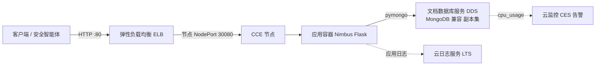

# 架构说明（Architecture）

> 本实践是一套**刻意保留安全漏洞**的演示应用，用于安全智能体（代码审查 + 渗透测试）与运维智能体（故障排查）的演练场景。架构本身遵循通用云原生分层结构：公网接入 → 容器计算 → 文档存储 → 可观测。

## 整体架构

## 关键组件

| 层 | 组件 | 职责 |
|---|---|---|
| 网络 | VPC / 子网 / 安全组 / 互联网网关 / 路由表 | 隔离网络平面，公网出口统一走 IGW |
| 接入 | 弹性负载均衡 ELB（独享型，绑定公网 EIP） | 对外暴露 HTTP :80，轮询转发到节点 NodePort 30080 |
| 计算 | 云容器引擎 CCE（托管集群 + 节点池） | 运行应用容器，节点规格 s6.large.2 |
| 应用 | Nimbus Flask（gunicorn，:8080） | 演示销售门户，内置 4 类刻意漏洞 |
| 存储 | 文档数据库服务 DDS（MongoDB 兼容，副本集 3 节点） | 存放 leads / notes 演示数据 |
| 可观测 | 云日志服务 LTS（日志组/流，7 天） | 收集应用日志，供排查 |
| 可观测 | 云监控服务 CES（告警规则） | 当 DDS CPU 使用率超阈值时触发告警（以数据库指标作为入口侧的可观测信号） |

## 数据流向

1. 客户端访问 ELB 公网地址（HTTP :80）。
2. ELB 将请求轮询转发到 CCE 节点的 NodePort 30080，再由集群路由到应用 Pod（:8080）。
3. 应用读写 DDS 中的 `demo-notes` 集合（leads / notes 两类文档）。
4. 应用日志写入 LTS；DDS 的 CPU 指标上报 CES，异常时告警。

## 关于「演示开关」的设计

应用支持环境变量 `BREAK_APP=true`：开启后数据访问路径主动抛出异常，使**数据页返回 HTTP 500**，而 `/health` 仍返回 200。这样应用日志（LTS）会报错、DDS CPU 指标会异常，从而形成一个**干净的 5xx 故障信号**，专门供运维智能体演练「应用层错误导致 5xx」的排查链路。

## 设计取舍

- **计算层选择 CCE 而非 Serverless 函数**：本应用为有状态 Web 服务，使用容器集群更贴近真实业务形态，也便于演示 NodePort 入口到 Pod 的路由链路。
- **存储层选择 DDS（MongoDB 兼容）**：数据模型为单表文档（leads / notes），文档数据库天然契合，且 pymongo 直连无需引入云厂商 SDK，依赖更干净。
- **接入层选择独享型 ELB**：SDK 实测 cn-north-4 该账号独享型可建（共享型不可用），提供 L7 HTTP :80 入口 + 轮询池，与 Terraform 显式声明的 listener/pool/member 组合共同实现传统应用负载均衡形态。创建时不显式传子网，由系统自动分配（显式传子网触发 ELB.8904）。
